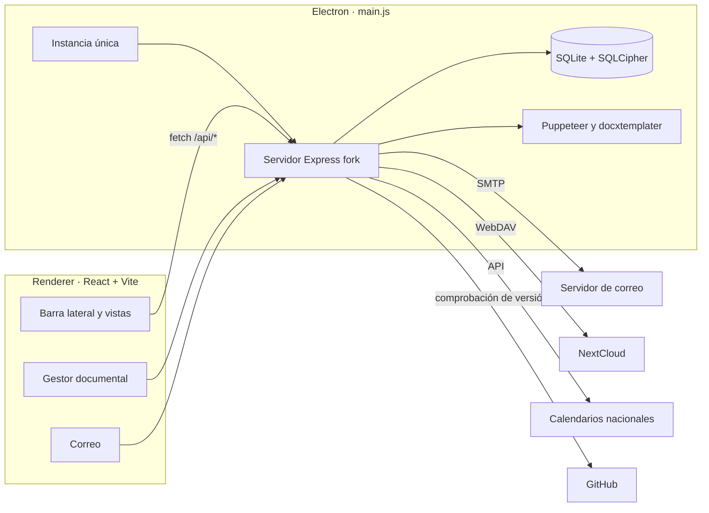
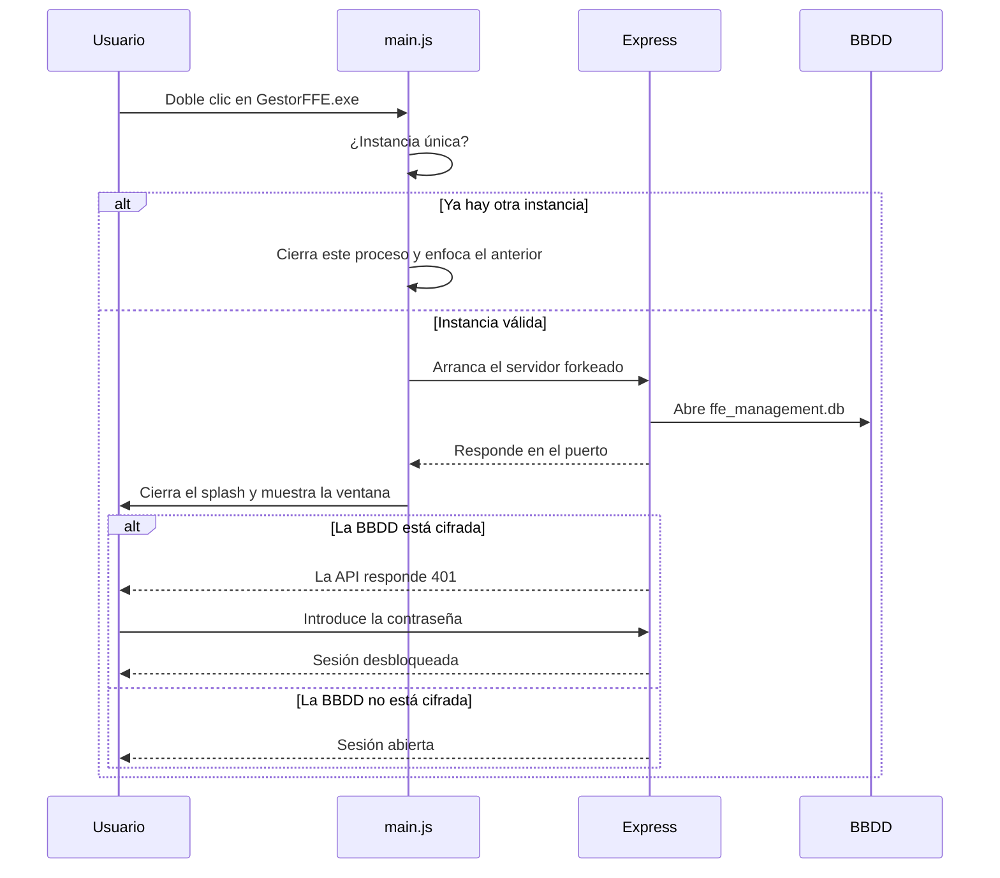
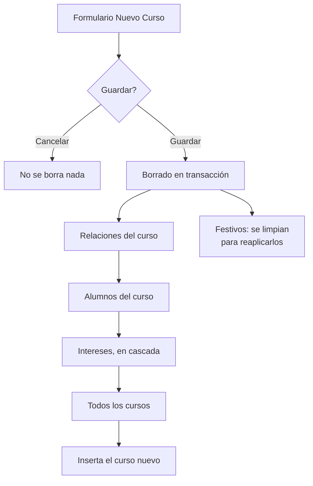
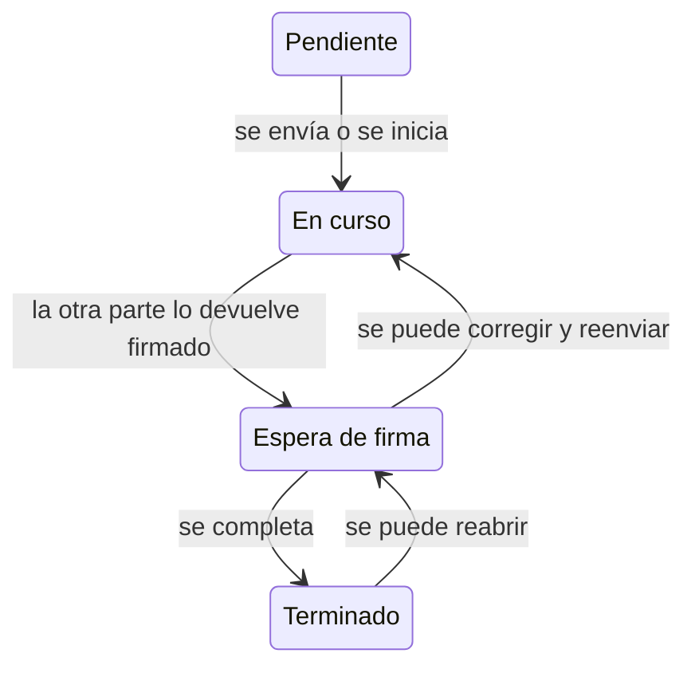
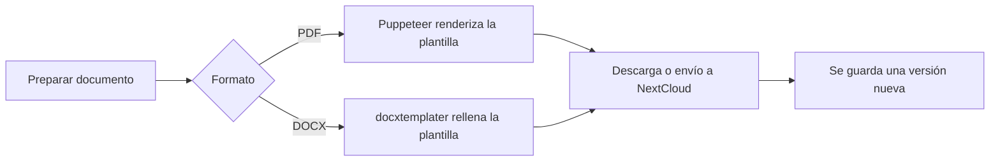

<div align="center">

</div>

# Gestor FFE - Sistema de Gestión de Prácticas Formativas

**Versión:** 0.1.20-alpha  
**Plataforma:** Windows (portable)

Aplicación de escritorio para la gestión integral de la Fase de Formación en Empresa
(FFE). Permite administrar alumnos, empresas, convenios, relaciones de prácticas,
generación de documentos oficiales, envío de correos electrónicos y cálculo de días de
Seguridad Social, todo en un mismo entorno.

---

## Documentación

El manual de uso está en **[`docs/`](docs/README.md)**, dividido en 18 documentos:

1. [Introducción](docs/01-introduccion.md) - qué es la aplicación, condiciones de uso y copyright
2. [Primeros pasos](docs/02-primeros-pasos.md) - instalación, desbloqueo y navegación
3. [Módulo de Profesor y Centros](docs/03-modulo-de-profesor.md) - datos personales, centros y ciclos
4. [Cursos](docs/04-cursos.md) - cursos académicos
5. [Alumnos](docs/05-alumnos.md) - alta, importación desde Excel y CV
6. [Empresas](docs/06-empresas.md) - empresas colaboradoras y tutores
7. [Intereses Alumno-Empresa](docs/07-intereses-alumno-empresa.md) - preferencias bidireccionales
8. [Convenios](docs/08-convenios.md) - convenios de colaboración y sus estados
9. [Relaciones Alumno-Empresa](docs/09-relaciones-alumno-empresa.md) - horarios, fechas y estados
10. [Generación de Documentos](docs/10-generacion-de-documentos.md) - documentos oficiales y calendario
11. [Correo Electrónico](docs/11-correo-electronico.md) - SMTP, plantillas y marcadores
12. [Panel de Control](docs/12-panel-de-control.md) - resumen, estadísticas y Seguridad Social
13. [Configuración](docs/13-configuracion.md) - avisos, festivos, ficheros, DAT y cifrado
14. [Histórico / Auditoría](docs/14-historico-auditoria.md) - registro de operaciones
15. [Seguridad y Cifrado](docs/15-seguridad-y-cifrado.md) - SQLCipher y bloqueo
16. [Servicios conectados](docs/16-servicios-conectados.md) - servicios externos
17. [Preguntas Frecuentes](docs/17-preguntas-frecuentes.md) - dudas habituales
18. [Comunicaciones DAT](docs/18-comunicaciones-dat.md) - envíos a la DAT y su estado de trámite

Documentación técnica para quien mantiene la aplicación:
[Seguridad interna](docs/seguridad-interna.md).

---

## Módulos

La barra lateral se habilita por pasos: **Profesor** siempre está disponible, y el resto
de módulos se desbloquean según haya un profesor configurado y un curso seleccionado.

| Módulo | Para qué sirve | Documento |
|--------|----------------|-----------|
| **Profesor** | Tus datos personales | [3](docs/03-modulo-de-profesor.md) |
| **Cursos** | Curso académico en curso: fechas, detalle y cycles | [4](docs/04-cursos.md) |
| **Centros** | Centros educativos, ciclos formativos y festivos del centro | [3](docs/03-modulo-de-profesor.md) |
| **Panel** | Resumen del curso, Seguridad Social, firmas y columnas DAT | [12](docs/12-panel-de-control.md) |
| **Alumnos** | Alta, importación desde Excel, CV y datos de contacto | [5](docs/05-alumnos.md) |
| **Empresas** | Empresas colaboradoras, tutores y estadísticas | [6](docs/06-empresas.md) |
| **Intereses** | Preferencias alumno ↔ empresa en ambos sentidos | [7](docs/07-intereses-alumno-empresa.md) |
| **Convenios** | Convenios de colaboración y su flujo de estados | [8](docs/08-convenios.md) |
| **Relaciones** | Periodos de prácticas, horarios y fecha de fin calculada | [9](docs/09-relaciones-alumno-empresa.md) |
| **Enviar a la DAT** | Envíos documentales a la DAT y su estado de trámite | [18](docs/18-comunicaciones-dat.md) |

En la fila superior de iconos están **Histórico**, **Tema**, **Descargas**, **Avisos** y
**Configuración**, además del selector de ciclo.

---

## Arquitectura



- El proceso principal (`main.js`) hace de servidor: forkea `dist-server/server.js`, espera a
  que responda y entonces abre la ventana. El renderer nunca habla con la base de datos.
- La base de datos es un único fichero `ffe_management.db` (SQLite con SQLCipher) junto al
  ejecutable.
- Los PDF se generan en el servidor con Puppeteer y los DOCX con docxtemplater, así que no
  hace falta tener Word ni LibreOffice instalados.

## Flujo de arranque



El servidor escucha en el puerto `3000` en producción y en el `3100` en desarrollo, y el
renderer llama siempre a rutas `/api` del mismo origen. Si el servidor no responde en 10
segundos, la aplicación avisa y se cierra en lugar de mostrar una ventana vacía.

## Un único curso activo

La aplicación trabaja con **un solo curso a la vez**: al guardar un curso nuevo, sustituye
al anterior. El borrado y el alta ocurren en una sola transacción, de forma que **cancelar
el formulario no pierde nada**.



| Se conserva | Se elimina |
|-------------|------------|
| Empresas, sus tutores y sus datos | Relaciones de prácticas del curso |
| Convenios (se quedan sin curso asignado) | Alumnos, y con ellos sus intereses y documentos |
| Centros educativos y ciclos | Festivos, para poder reaplicarlos al curso nuevo |
| Histórico y auditoría (guardan copia de los datos, sin claves foráneas) | |

> ⚠️ Crea una copia de `ffe_management.db` antes de sustituir el curso si quieres
> conservar el histórico anterior.

## Estados y documentos

Los trámites (convenios, relaciones, comunicaciones DAT, plan formativo, seguimiento y
valoración) comparten una escala de estados común, para que el color signifique lo mismo en
todos los módulos.



No todos los trámites pasan por los cuatro niveles: cada uno usa los que le corresponden y
el texto de cada estado es el del módulo (por ejemplo, el convenio espera la firma de la
dirección y el plan formativo la del tutor). Lo que es común es el **color**.



---

## Para empezar

1. Descarga el `.exe` `GestorFFE.exe`.
2. Si la base de datos tiene contraseña, introdúcela en la pantalla de desbloqueo.
3. Ve a **Configuración** y revisa los avisos, los festivos y el correo antes de empezar.

> ⚠️ **Se recomienda cifrar la base de datos para proteger los datos de los estudiantes.**
> Si decides hacerlo, la contraseña **no es recuperable**: si la olvidas, los datos se
> pierden para siempre.

La aplicación se ejecuta en el propio ordenador: no necesita servidor ni conexión a
internet, salvo para obtener los festivos por localidad, para enviar correos y para
comprobar si hay actualizaciones.

## Empaquetado

`electron-builder` genera dos formatos para Windows:

| Formato | Archivo | Notas |
|---------|---------|-------|
| **Portable** | `release/GestorFFE.exe` | Un único ejecutable. Al abrirlo se descomprime en una carpeta temporal y muestra un splash mientras termina. No instala nada. |
| **NSIS** | `release/Gestor FFE Setup <versión>.exe` | Instalador clásico: deja elegir el directorio de instalación, crea el acceso directo del escritorio y muestra `info_instalador.txt` como licencia. |

El destino de salida es `release/`, que se limpia antes de cada empaquetado. Para Windows el
icono es `assets/favicon.png` y para Linux se genera un `AppImage`.

---

## Condiciones de uso

El usuario es responsable de cumplir con todas las leyes y regulaciones aplicables al utilizar este software.

El desarrollador de esta aplicación **no se hace responsable** de ningún daño, pérdida o perjuicio que pueda derivarse del uso indebido, inapropiado o incorrecto de la aplicación. El uso de esta aplicación es a su propio riesgo.

**No garantizamos** que la aplicación funcione sin errores, interrupciones o fallos, ni que los resultados obtenidos sean precisos o completos. La aplicación se proporciona "tal cual" y "según disponibilidad", sin ninguna garantía expresa o implícita de ningún tipo.

Al utilizar esta aplicación, usted **acepta que el desarrollador no será responsable** de ningún daño directo, indirecto, incidental, especial o consecuente que pueda surgir del uso o mal funcionamiento de la aplicación.

El desarrollador no se hace responsable de la gestión, almacenamiento o protección de los datos introducidos en la aplicación. Es responsabilidad del usuario asegurarse de que los datos gestionados cumplen con la normativa vigente en materia de protección de datos.

### Derechos de autor

Copyright (c) Manuel Jesús Herrera Morgaz. Todos los derechos reservados.

Este software se distribuye bajo una licencia de código fuente disponible. Se permite usar, ver y estudiar el código. <a href="https://github.com/mjherrera-fp/gestor-ffe" target="_blank" rel="noopener noreferrer">El código fuente está disponible en GitHub</a>.

No se permite copiar, redistribuir, sublicenciar o usar con fines comerciales o de ningún otro tipo sin autorización expresa del autor.

Toda copia autorizada deberá mantener esta nota de copyright y atribuir al autor original.

Al aceptar estas condiciones, el usuario se compromete a hacer un uso responsable de la aplicación y de los datos gestionados a través de la misma.

---

## Para desarrollar

```bash
npm install
npm run dev                   # servidor de desarrollo + Electron
npm run lint                  # comprobación de tipos (tsc --noEmit)
npm test                      # tests unitarios (vitest)
npm run test:integration      # tests de integración contra un servidor real
npm run build                 # renderer -> dist/
npm run build:server          # server.ts -> dist-server/server.js
npm run pack:win              # instalador NSIS + portable
npm run pack:win:portable     # solo el portable
```

`npm run dev` recompila el módulo nativo `better-sqlite3-multiple-ciphers` contra la versión
de Node antes de arrancar. `pack:win` lo recompila contra la de Electron, que es un ABI
distinto.

La base de datos (`ffe_management.db`) se crea junto al ejecutable. En desarrollo se
puede aislar en un directorio propio con la variable `PORTABLE_EXECUTABLE_DIR`, que es
como se ejecutan las pruebas sin tocar los datos reales.

---

## Pendiente

- [ ] **Desbloqueo biométrico (Windows Hello).** La integración existe pero sigue sin
  revisar; los puntos abiertos están en
  [Seguridad interna](docs/seguridad-interna.md#2-windows-hello--desbloqueo-biométrico).
  Mientras tanto, el desbloqueo es siempre por contraseña.
- [ ] **Publicar el repositorio y cambiar el actualizador.** Mientras GitHub sea privado,
  el actualizador lleva un token dentro del `.exe`. Está descrito en
  [Seguridad interna](docs/seguridad-interna.md#1-el-token-de-github-viaja-dentro-del-exe-distribuido).
